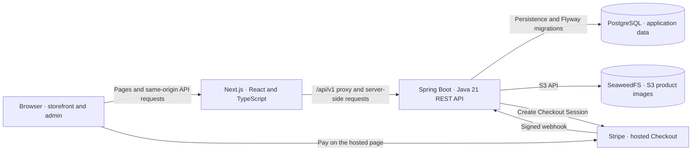
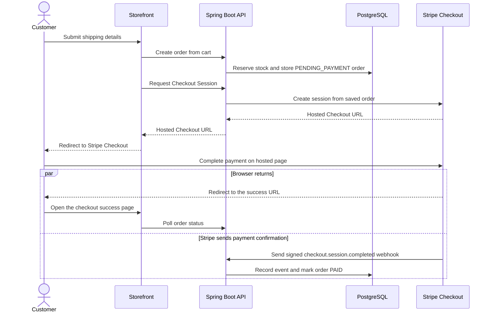

# E-commerce Platform

A storefront and administration console for managing a product catalog, inventory, and customer orders. Shoppers can browse products, manage a cart, pay through Stripe Checkout, and track their orders. Store operators can manage products and images, adjust inventory, and update fulfillment from the admin area.

| Storefront | Administration |
| --- | --- |
| Search and filter the catalog by category, price, and availability | Create and edit products and categories, and upload and reorder product images |
| Manage a cart, enter a shipping address, and pay through Stripe Checkout | View exact inventory counts and adjust stock |
| View order history and manage account details | Review sales and low-stock products, and manage order statuses |

## Architecture



- **Frontend** uses the Next.js App Router and TanStack Query. The same-origin API proxy keeps the HTTP-only refresh cookie on the storefront origin. Short-lived JWT access tokens are held in browser memory.
- **Backend** is a modular monolith. It owns authorization, pricing, stock validation, and order state. Shoppers see product availability. Exact inventory counts are available to administrators.
- **Storage** uses PostgreSQL for application data and S3-compatible object storage for product images. The backend serves images through the product API.

### Checkout and payment confirmation



The backend verifies Stripe signatures and records event IDs to process webhook retries idempotently. The success page checks the saved order status while confirmation is pending. Unpaid orders are eventually canceled and reserved stock is released.

## Local development

### Prerequisites

- Docker with the `docker compose` command
- JDK 21 and Maven 3.9+
- Node.js 22.12+ and pnpm
- Stripe CLI for local payment testing and Python 3 for uploading demo photos

### 1. Configure and start the infrastructure

From the repository root, copy the environment template and generate a JWT secret.

```bash
cp .env.example .env
openssl rand -base64 48
```

Save the generated value as `JWT_SECRET` in `.env` and set `POSTGRES_PASSWORD`. The template supplies local S3 credentials and enables demo data on a fresh database. Complete [Stripe Sandbox setup](#stripe-sandbox-setup) to test payments.

```bash
docker compose up -d --wait
```

Compose starts PostgreSQL on port `5432` and the SeaweedFS S3 gateway on port `8333`. Run the application processes on the host in separate terminals.

### 2. Start the backend

Open a terminal at the repository root and start Spring Boot.

```bash
set -a
. ./.env
set +a
cd backend
mvn spring-boot:run
```

The backend listens on port `8080` and applies Flyway migrations at startup.

### 3. Start the frontend

Open another terminal at the repository root and start Next.js.

```bash
cd frontend
cp .env.example .env.local
pnpm install
pnpm dev
```

| Service | URL |
| --- | --- |
| Storefront | [http://localhost:3000](http://localhost:3000) |
| Admin console | [http://localhost:3000/admin](http://localhost:3000/admin) |
| Swagger UI | [http://localhost:8080/swagger-ui.html](http://localhost:8080/swagger-ui.html) |
| Health endpoint | [http://localhost:8080/actuator/health](http://localhost:8080/actuator/health) |

Stop the host processes with Ctrl+C and run `docker compose down` to stop the infrastructure and retain its data volumes.

### Demo accounts and product images

The root environment template includes `FLYWAY_LOCATIONS=classpath:db/migration,classpath:db/seed`. On a fresh database, Flyway loads the demo accounts and catalog. Use these credentials only for local development.

| Role | Email | Password |
| --- | --- | --- |
| Admin | `admin@example.com` | `Admin123!` |
| Customer | `customer@example.com` | `Customer123!` |

With the backend running, upload the demo photos from the repository root.

```bash
python3 scripts/seed-product-images.py
```

Enter the demo admin password when prompted. The script skips products that already have photos. Use `--email` or `--port` to override its defaults.

## Stripe Sandbox setup

The backend creates Stripe-hosted Checkout Sessions. It uses a Stripe API secret key to create sessions and a separate webhook signing secret to verify payment events.

1. Set `STRIPE_SECRET_KEY` in the root `.env` to the `sk_test_…` key for your Stripe Sandbox.
2. In a dedicated terminal at the repository root, load `.env` and **export `STRIPE_API_KEY` before starting Stripe CLI**. The listener must use the same Sandbox as the backend. [Stripe CLI API keys](https://github.com/stripe/stripe-cli/wiki/using-stripe-api-keys)

   ```bash
   set -a
   . ./.env
   set +a
   export STRIPE_API_KEY="$STRIPE_SECRET_KEY"

   stripe listen \
     --events checkout.session.completed,checkout.session.expired,payment_intent.payment_failed \
     --forward-to http://localhost:8080/api/v1/payments/webhook
   ```

3. Copy the listener's `whsec_…` value to `STRIPE_WEBHOOK_SECRET` in the root `.env`. Keep the listener running. Start the backend, or restart it using the commands above to reload `.env`. [Stripe CLI listen reference](https://docs.stripe.com/cli/listen)
4. Sign in as a customer and complete a new checkout with `4242 4242 4242 4242`, a future expiration date, and any three-digit CVC. Verify that the listener reports a successful delivery of `checkout.session.completed` and the order becomes `PAID`. [Stripe test cards](https://docs.stripe.com/testing)

If checkout remains on **Confirming your payment**, check whether the listener received the completion event. If the event never appeared, verify that the backend and listener use the same Sandbox key. If the backend rejected the delivery, check the forwarding URL and the listener's signing secret.

## Configuration reference

| Setting | Location | Usage |
| --- | --- | --- |
| `POSTGRES_DB`, `POSTGRES_USER`, `POSTGRES_PASSWORD`, `POSTGRES_PORT` | Root `.env` | Shared PostgreSQL settings for local Compose and the host backend. Defaults are `ecommerce` for the database and user, and `5432` for the port. |
| `JWT_SECRET` | Backend environment | JWT signing key of at least 32 bytes. |
| `S3_ACCESS_KEY`, `S3_SECRET_KEY`, `S3_PORT` | Root `.env` | Local SeaweedFS credentials and gateway port. The port defaults to `8333`. |
| `S3_ENDPOINT`, `S3_BUCKET`, `S3_REGION`, `S3_PATH_STYLE` | Backend environment | Object storage overrides. The local bucket defaults to `ecommerce-media`. |
| `STRIPE_SECRET_KEY`, `STRIPE_WEBHOOK_SECRET` | Backend environment | Stripe API credentials and signing secret for the active webhook destination or CLI listener. |
| `PUBLIC_URL` | Backend environment | Storefront origin for Stripe return URLs and the default allowed CORS origin. Defaults to `http://localhost:3000`. |
| `API_URL`, `NEXT_PUBLIC_API_URL` | Frontend environment | Set `API_URL` to the backend base URL. It defaults to `http://localhost:8080` and is used when building the proxy rewrite. Leave `NEXT_PUBLIC_API_URL` empty for same-origin browser requests. |

See [backend configuration](backend/src/main/resources/application.yml) and the [frontend environment template](frontend/.env.example) for additional settings.

### Hosted environments

The [backend Dockerfile](backend/Dockerfile) and [frontend Dockerfile](frontend/Dockerfile) build the applications separately. Configure the frontend image's `API_URL` build argument and runtime environment to point to the backend from the frontend container. Supply the backend with its database and object storage settings, set `PUBLIC_URL` to the HTTPS storefront origin, and keep `JWT_REFRESH_COOKIE_SECURE=true`. Use a production database with only the schema migrations and provision the first administrator with a unique password.

Configure a Stripe webhook destination at the publicly reachable HTTPS URL for `POST /api/v1/payments/webhook`. Subscribe to the same three events listed in the Sandbox setup and set `STRIPE_WEBHOOK_SECRET` to that destination's signing secret. [Stripe webhooks](https://docs.stripe.com/webhooks)

## Checks and tests

Run the checks from the repository root.

```bash
(cd backend && mvn -B verify)
(cd frontend && pnpm lint && pnpm typecheck && pnpm test --run)
```

The backend integration tests require a running Docker daemon for PostgreSQL Testcontainers. To build the frontend, run `pnpm build` from `frontend/` with the target `API_URL` configured.

## Repository layout

| Path | Contents |
| --- | --- |
| [`backend/`](backend/) | Spring Boot API, Flyway migrations, and backend tests. See the [backend guide](backend/README.md). |
| [`frontend/`](frontend/) | Next.js storefront, administration console, and frontend tests. See the [frontend guide](frontend/README.md). |
| [`infra/seaweedfs/`](infra/seaweedfs/) | Local SeaweedFS configuration. |
| [`scripts/`](scripts/) | Demo photo upload script and its assets. |
| [`docker-compose.yml`](docker-compose.yml) | Local PostgreSQL and SeaweedFS services. |
